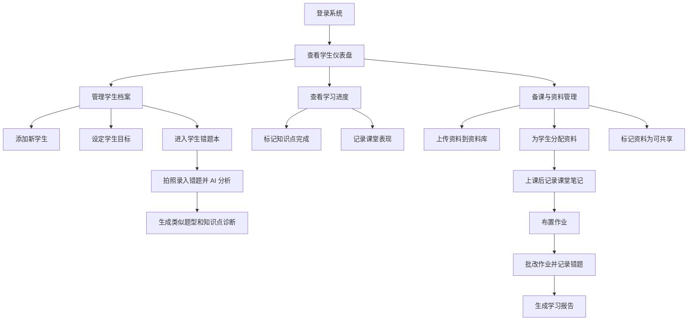

# C-teacher 产品需求文档

> 版本: v1.0.3 | 更新日期: 2026-05-30  
> 文档来源: 需求分析过程.md, 功能模块.xlsx, 需求记录.txt

## 需求概述

### 背景

C-teacher 面向教师的一对多个性化教学管理场景，帮助教师管理学生档案、学习计划、课堂记录、教学资料、作业批改和阶段性学习反馈。

### 产品目标

- 建立以学生为中心的教学管理工作台。
- 支持教师按学生进度分配资料、记录课堂、跟踪作业和复盘学习效果。
- 通过资料复用、进度看板、报告生成和智能推荐，逐步降低重复备课与线下沟通成本。

### 目标用户

- 主要用户: 教师、教研人员、个人辅导老师。
- 间接用户: 学生、家长。

## 平台与系统能力

| 能力 | 阶段 | 优先级 | 是否 MVP | 描述 | 来源 |
| --- | --- | --- | --- | --- | --- |
| macOS 优先支持 | V1 | P0 | 是 | 产品优先面向 macOS 使用场景交付，教师端体验需优先适配 macOS 桌面环境。 | 用户补充 |
| 移动端支持 | V1 | P0 | 是 | 支持移动端访问核心功能，至少覆盖查看资料、查看学习计划、课堂记录查看、作业查看等轻量场景。 | 用户补充 |
| 系统提醒调用 | V1 | P0 | 是 | 支持调用系统提醒能力，用于课程、作业、批改、学习报告等关键事项提醒。 | 用户补充 |

> ⚠️ 待确认  
> - “系统提醒”具体指 macOS 通知中心、本机“提醒事项”App、日历提醒，还是跨端推送通知。当前 PRD 先按“可调用系统级提醒能力”描述，不限定具体技术实现。

## 路线图

| 阶段 | 范围 | 周期 | 包含需求 | 说明 | 来源 |
| --- | --- | --- | --- | --- | --- |
| V1 | MVP | 6 周 | P0 | 学生档案、学生错题本入口、个性化学习计划、课堂记录、资料库、资料-学生关联、macOS 优先教师端、移动端核心适配、系统提醒调用 | 需求记录.txt, 功能模块.xlsx, 需求分析过程.md, 用户补充 |
| V2 | 增强版 | 4 周 | P1 | 资料共享与复用、进度看板、作业与批改跟踪、错题本 AI 分析、资料打标签/搜索 | 需求记录.txt, 需求分析过程.md, 用户补充 |
| V3 | 智能化 | 6 周 | P1 + P2 | 学习报告自动生成、智能备课推荐、学生自助端、知识点图谱、跨知识点错因洞察 | 需求记录.txt, 需求分析过程.md, 用户补充 |

> ⚠️ 待确认  
> - `功能模块.xlsx` 将“资料库: 上传/存储/分类/标签”列入 MVP；`需求记录.txt` 将“资料打标签/搜索”列入 V2。当前 PRD 将基础分类归入 MVP，将标签/搜索能力标记为 V2，需确认最终边界。
> - `功能模块.xlsx` 将“多学生分配”列入 MVP；`需求记录.txt` 将“资料共享与复用（多选分配）”列入 V2。当前 PRD 将基础单学生资料分配归入 MVP，将多选/复用/推荐能力标记为 V2，需确认最终边界。

## 功能模块

### 模块 1: 学生管理

| 功能 ID | 功能 | 阶段 | 优先级 | 是否 MVP | 描述 | 来源 |
| --- | --- | --- | --- | --- | --- | --- |
| REQ-001 | 学生档案管理 | V1 | P0 | 是 | 创建、编辑、查看、删除学生基本信息、学习目标、起始水平；学生以卡片形式展示课程信息，且一个学生可关联多个学科。 | 需求分析过程.md, 用户补充 |
| REQ-017 | 学生错题本入口 | V1 | P0 | 是 | 一个学生对应一个错题本，错题本按科目组织；不作为一级菜单，在学生管理卡片和学生概览中提供显眼入口。 | 用户补充 |
| REQ-018 | AI 错题分析与练习生成 | V2 | P1 | 否 | 接入 AI 模型，支持拍照识别错题、辅助改题、错误原因分析、相似题生成和知识点掌握分析。 | 用户补充 |

### 模块 2: 个性化学习计划

| 功能 ID | 功能 | 阶段 | 优先级 | 是否 MVP | 描述 | 来源 |
| --- | --- | --- | --- | --- | --- | --- |
| REQ-002 | 个性化学习计划 | V1 | P0 | 是 | 为每个学生设定独立课程大纲、课时安排和学习目标。 | 需求分析过程.md |
| REQ-011 | 知识点图谱 | V3 | P2 | 否 | 建立学科知识图谱，可视化每个学生的知识掌握情况和薄弱环节。 | 需求分析过程.md |

### 模块 3: 课堂记录

| 功能 ID | 功能 | 阶段 | 优先级 | 是否 MVP | 描述 | 来源 |
| --- | --- | --- | --- | --- | --- | --- |
| REQ-003 | 课堂记录系统 | V1 | P0 | 是 | 每节课后记录授课内容、学生表现和作业布置。 | 需求分析过程.md |
| REQ-013 | 课堂 AI 纪要 | V3 | P2 | 否 | 语音记录课堂内容，自动生成结构化课堂笔记。 | 需求分析过程.md |

### 模块 4: 资料库与资料分配

| 功能 ID | 功能 | 阶段 | 优先级 | 是否 MVP | 描述 | 来源 |
| --- | --- | --- | --- | --- | --- | --- |
| REQ-004 | 资料库管理 | V1 | P0 | 是 | 上传、分类、存储教学资料，支持 PDF、图片、视频、文档等类型。 | 需求分析过程.md, 功能模块.xlsx |
| REQ-005 | 资料-学生关联 | V1 | P0 | 是 | 将资料与学生绑定，学生只能看到自己分配的资料。 | 需求分析过程.md |
| REQ-006 | 资料共享与复用 | V2 | P1 | 否 | 标记资料为可共享，并推荐给进度相近的学生，减少重复备课。 | 需求分析过程.md, 需求记录.txt |
| REQ-010 | 智能备课推荐 | V3 | P1 | 否 | 基于学生当前进度和薄弱点，推荐合适的教学资料。 | 需求分析过程.md |
| REQ-016 | 外部共享资料连接 | V1 | P0 | 是 | 学习资料支持连接 FTP、SMB 等共享协议，用于从外部共享目录导入或引用教学资料。 | 用户补充 |

### 模块 5: 进度与作业跟踪

| 功能 ID | 功能 | 阶段 | 优先级 | 是否 MVP | 描述 | 来源 |
| --- | --- | --- | --- | --- | --- | --- |
| REQ-007 | 进度看板 | V2 | P1 | 否 | 可视化展示所有学生的学习进度，如已完成、进行中、待开始知识点。 | 需求分析过程.md |
| REQ-008 | 作业与批改跟踪 | V2 | P1 | 否 | 在线布置作业，记录批改状态和错题集。 | 需求分析过程.md |

### 模块 6: 提醒与日程

| 功能 ID | 功能 | 阶段 | 优先级 | 是否 MVP | 描述 | 来源 |
| --- | --- | --- | --- | --- | --- | --- |
| REQ-015 | 系统提醒调用 | V1 | P0 | 是 | 支持为课程、作业、批改、学习报告等关键事项创建系统提醒。 | 用户补充 |

### 模块 7: 报告与学生端

| 功能 ID | 功能 | 阶段 | 优先级 | 是否 MVP | 描述 | 来源 |
| --- | --- | --- | --- | --- | --- | --- |
| REQ-009 | 学习报告自动生成 | V3 | P1 | 否 | 按周/月生成学生学习报告，包含掌握率、学习时长、进步曲线。 | 需求分析过程.md |
| REQ-014 | 学生自助端（小程序） | V3 | P2 | 否 | 学生可查看资料、提交作业、查看学习报告。 | 需求分析过程.md |

### 模块 8: 排课

| 功能 ID | 功能 | 阶段 | 优先级 | 是否 MVP | 描述 | 来源 |
| --- | --- | --- | --- | --- | --- | --- |
| REQ-012 | 智能排课助手 | V3 | P2 | 否 | 结合学生空闲时间和教师日程，自动推荐排课方案。 | 需求分析过程.md |

## MVP 范围

### MVP 功能清单

| 模块 | MVP 功能 | 预估工时 | 来源 |
| --- | --- | --- | --- |
| 学生管理 | 学生 CRUD + 基本信息 + 多学科课程卡片 | 1 周 | 功能模块.xlsx, 用户补充 |
| 学生错题本入口 | 学生卡片显眼入口 + 按科目错题概览 | 待估 | 用户补充 |
| 个性化学习计划 | 知识点拆解 + 状态管理 | 2 周 | 功能模块.xlsx |
| 课堂记录 | 新增/查看/编辑记录 | 1 周 | 功能模块.xlsx |
| 资料库 | 上传/存储/分类 | 2 周 | 功能模块.xlsx |
| 外部共享资料连接 | FTP/SMB 等共享协议连接 | 待估 | 用户补充 |
| 资料分配 | 单学生资料分配 | 2 周 | 功能模块.xlsx |
| macOS 优先支持 | 教师端优先适配 macOS 桌面环境 | 待估 | 用户补充 |
| 移动端支持 | 移动端核心功能查看与轻量操作 | 待估 | 用户补充 |
| 系统提醒调用 | 课程、作业、批改、报告等关键事项提醒 | 待估 | 用户补充 |

> MVP 总周期: 6 周（2 个迭代）  
> 说明: Excel 模块工时合计为 8 周，但表格总计写明 6 周（2 个迭代），此处保留原始总计并作为待确认项列入附录。

## 页面结构

### 页面清单

| 页面 | 阶段 | 主要能力 |
| --- | --- | --- |
| 登录页 | V1 | 教师登录系统 |
| 学生仪表盘 | V1 | 查看学生列表、学习状态和待处理事项 |
| 学生管理页 | V1 | 卡片形式展示学生课程信息，支持新增、查看、编辑、删除学生；一个学生可关联多个学科；提供显眼错题本入口 |
| 学习计划页 | V1 | 维护课程大纲、知识点和学习状态 |
| 课堂记录页 | V1 | 新增、查看、编辑课堂记录 |
| 资料库页 | V1 | 上传资料、分类存储、查看资料，连接 FTP/SMB 等外部共享目录 |
| 资料分配页 | V1 | 为学生分配资料 |
| 提醒设置页 | V1 | 创建、查看、管理课程、作业、批改和报告提醒 |
| 进度看板页 | V2 | 查看学生学习进度 |
| 作业批改页 | V2 | 布置作业、跟踪批改状态和错题 |
| 学生错题本 | V2 | 从学生管理进入，按学生和科目管理错题，支持 AI 拍照改题、错误分析、相似题生成和知识点分析 |
| 学习报告页 | V3 | 查看周/月学习报告 |
| 移动端核心页面 | V1 | 在移动端查看资料、学习计划、课堂记录和作业 |
| 学生小程序端 | V3 | 学生查看资料、提交作业、查看学习报告 |

### 页面关系图

## 数据字段

### 实体 1: 学生

| 字段名 | 类型 | 必填 | 说明 | 来源 |
| --- | --- | --- | --- | --- |
| id | 待补充 | 是 | 学生唯一标识 | 推断自学生档案管理 |
| name | 待补充 | 是 | 学生姓名 | 需求分析过程.md |
| basic_info | 待补充 | 否 | 学生基本信息 | 需求分析过程.md |
| learning_goal | 待补充 | 否 | 学习目标 | 需求分析过程.md |
| initial_level | 待补充 | 否 | 起始水平 | 需求分析过程.md |
| subjects | array | 是 | 学生关联的多个学科及课程状态 | 用户补充 |
| learning_style | 待补充 | 否 | 学生学习风格，如图像化讲解、短任务、高频反馈 | 用户补充 |
| mistake_book_id | 待补充 | 是 | 该学生对应的唯一错题本 | 用户补充 |

### 实体 2: 学习计划

| 字段名 | 类型 | 必填 | 说明 | 来源 |
| --- | --- | --- | --- | --- |
| student_id | 待补充 | 是 | 关联学生 | 需求分析过程.md |
| syllabus | 待补充 | 是 | 课程大纲 | 需求分析过程.md |
| lesson_schedule | 待补充 | 否 | 课时安排 | 需求分析过程.md |
| learning_goal | 待补充 | 否 | 学习目标 | 需求分析过程.md |
| knowledge_status | 待补充 | 否 | 知识点状态 | 功能模块.xlsx |

### 实体 3: 课堂记录

| 字段名 | 类型 | 必填 | 说明 | 来源 |
| --- | --- | --- | --- | --- |
| student_id | 待补充 | 是 | 关联学生 | 需求分析过程.md |
| lesson_content | 待补充 | 是 | 授课内容 | 需求分析过程.md |
| performance | 待补充 | 否 | 学生表现 | 需求分析过程.md |
| homework | 待补充 | 否 | 作业布置 | 需求分析过程.md |

### 实体 4: 教学资料

| 字段名 | 类型 | 必填 | 说明 | 来源 |
| --- | --- | --- | --- | --- |
| id | 待补充 | 是 | 资料唯一标识 | 推断自资料库管理 |
| title | 待补充 | 是 | 资料名称 | 推断自资料库管理 |
| file_type | 待补充 | 是 | PDF、图片、视频、文档等资料类型 | 需求分析过程.md |
| category | 待补充 | 否 | 资料分类 | 需求分析过程.md |
| tags | 待补充 | 否 | 资料标签 | 功能模块.xlsx |
| shareable | boolean | 否 | 是否可共享 | 需求分析过程.md |
| source_type | enum | 是 | 资料来源，如本地上传、FTP、SMB | 用户补充 |
| source_path | string | 否 | 外部共享目录或文件路径 | 用户补充 |
| sync_status | 待补充 | 否 | 外部资料连接或同步状态 | 用户补充 |

### 实体 5: 作业与批改

| 字段名 | 类型 | 必填 | 说明 | 来源 |
| --- | --- | --- | --- | --- |
| student_id | 待补充 | 是 | 关联学生 | 需求分析过程.md |
| homework_content | 待补充 | 是 | 作业内容 | 需求分析过程.md |
| grading_status | 待补充 | 是 | 批改状态 | 需求分析过程.md |
| mistake_set | 待补充 | 否 | 错题集 | 需求分析过程.md |

### 实体 6: 系统提醒

| 字段名 | 类型 | 必填 | 说明 | 来源 |
| --- | --- | --- | --- | --- |
| id | 待补充 | 是 | 提醒唯一标识 | 用户补充 |
| related_type | 待补充 | 是 | 关联事项类型，如课程、作业、批改、学习报告 | 用户补充 |
| related_id | 待补充 | 否 | 关联事项 ID | 用户补充 |
| remind_at | datetime | 是 | 提醒时间 | 用户补充 |
| title | string | 是 | 提醒标题 | 用户补充 |
| status | 待补充 | 是 | 提醒状态 | 用户补充 |

### 实体 7: 外部资料源

| 字段名 | 类型 | 必填 | 说明 | 来源 |
| --- | --- | --- | --- | --- |
| id | 待补充 | 是 | 外部资料源唯一标识 | 用户补充 |
| protocol | enum | 是 | 共享协议，如 FTP、SMB | 用户补充 |
| name | string | 是 | 资料源名称 | 用户补充 |
| host | string | 是 | 服务器地址 | 用户补充 |
| path | string | 否 | 默认共享目录路径 | 用户补充 |
| auth_method | 待补充 | 是 | 认证方式 | 用户补充 |
| connection_status | 待补充 | 是 | 连接状态 | 用户补充 |

### 实体 8: 学生错题本

| 字段名 | 类型 | 必填 | 说明 | 来源 |
| --- | --- | --- | --- | --- |
| id | 待补充 | 是 | 错题本唯一标识 | 用户补充 |
| student_id | 待补充 | 是 | 关联学生，一个学生对应一个错题本 | 用户补充 |
| subjects | array | 是 | 按科目组织错题，如数学、英语、语文、物理 | 用户补充 |
| mistake_count | number | 否 | 当前错题数量 | 用户补充 |
| weak_knowledge_points | array | 否 | 高频薄弱知识点 | 用户补充 |
| last_analysis_at | datetime | 否 | 最近一次 AI 分析时间 | 用户补充 |

### 实体 9: 错题

| 字段名 | 类型 | 必填 | 说明 | 来源 |
| --- | --- | --- | --- | --- |
| id | 待补充 | 是 | 错题唯一标识 | 用户补充 |
| mistake_book_id | 待补充 | 是 | 关联错题本 | 用户补充 |
| subject | enum | 是 | 所属科目 | 用户补充 |
| photo_url | string | 否 | 拍照或上传的题目图片 | 用户补充 |
| question_text | text | 否 | AI/OCR 识别出的题干 | 用户补充 |
| student_answer | text | 否 | 学生答案 | 用户补充 |
| correct_answer | text | 否 | 标准答案或教师修订答案 | 用户补充 |
| mistake_reason | text | 否 | AI 生成的错误原因分析 | 用户补充 |
| knowledge_points | array | 否 | 涉及知识点 | 用户补充 |
| similar_questions | array | 否 | AI 生成的类似题型 | 用户补充 |
| review_status | enum | 是 | 待订正、已订正、已掌握等状态 | 用户补充 |

## 附录

### 整合摘要

| 项目 | 数量 |
| --- | ---: |
| 解析文档 | 3 |
| 功能模块 | 8 |
| 功能项 | 18 |
| 去重合并 | 5 |
| 信息补充 | 11 |
| 待确认事项 | 5 |

### 合并记录

| 合并项 | 合并说明 | 来源 |
| --- | --- | --- |
| 学生档案管理 | `REQ-001` 与 Excel“学生管理: 学生 CRUD + 基本信息”合并。 | 需求分析过程.md, 功能模块.xlsx |
| 个性化学习计划 | `REQ-002` 与 Excel“知识点拆解 + 状态管理”合并。 | 需求分析过程.md, 功能模块.xlsx |
| 课堂记录系统 | `REQ-003` 与 Excel“新增/查看/编辑记录”合并。 | 需求分析过程.md, 功能模块.xlsx |
| 资料库管理 | `REQ-004` 与 Excel“上传/存储/分类/标签”合并，标签范围待确认。 | 需求分析过程.md, 功能模块.xlsx |
| 资料-学生关联 | `REQ-005` 与 Excel“资料分配”合并，单学生/多学生范围待确认。 | 需求分析过程.md, 功能模块.xlsx |

### 待确认事项

#### 范围冲突

- **资料标签/搜索阶段**
  - `功能模块.xlsx`: 资料库包含“上传/存储/分类/标签”，列入 MVP。
  - `需求记录.txt`: “资料打标签/搜索”列入 V2。
  - 当前处理: 基础分类归入 MVP，标签/搜索归入 V2。

- **多学生资料分配阶段**
  - `功能模块.xlsx`: 资料分配包含“单学生分配 + 多学生分配”，列入 MVP。
  - `需求记录.txt`: “资料共享与复用（多选分配）”列入 V2。
  - 当前处理: 单学生分配归入 MVP，多选分配/共享复用归入 V2。

#### 工期口径

- `功能模块.xlsx` 明细工时为 1 + 2 + 1 + 2 + 2 = 8 周，但总计写明“6 周（2 个迭代）”。
- 当前处理: 保留“6 周（2 个迭代）”作为 MVP 总周期，明细工时需确认是否存在并行开发或估算调整。

#### 系统提醒实现口径

- 用户补充要求“支持调用系统提醒”。
- 当前处理: 记录为 V1/P0/MVP 能力，但具体接入对象待确认：macOS 通知中心、本机“提醒事项”App、日历提醒或跨端推送通知。

#### 外部共享资料连接口径

- 用户补充要求学习资料支持连接 FTP 或 SMB 等共享协议。
- 当前处理: 记录为 V1/P0/MVP 能力，但具体认证方式、是否缓存文件、是否仅引用路径、同步频率和权限边界待确认。

#### AI 错题本实现口径

- 用户补充要求错题本接入 AI 模型，支持拍照改题、错误分析、类似题型生成和知识点分析。
- 当前处理: 错题本入口归入 V1/P0/MVP；AI 拍照改题与分析能力归入 V2/P1，具体模型、OCR 能力、题目图片存储、教师审核机制和生成题质量标准待确认。

### 变更历史

| 版本 | 日期 | 变更内容 | 变更人 |
| --- | --- | --- | --- |
| v1.0.0 | 2026-05-30 | 初始版本，由需求分析过程.md、功能模块.xlsx、需求记录.txt 整合生成。 | - |
| v1.0.1 | 2026-05-30 | 补充 macOS 优先支持、移动端支持、系统提醒调用要求。 | - |
| v1.0.2 | 2026-05-30 | 补充学生管理一级入口、多学科课程卡片、学生 CRUD、FTP/SMB 外部资料源连接。 | - |
| v1.0.3 | 2026-05-30 | 补充学生错题本入口、按科目错题本、AI 拍照改题、错误分析、类似题生成与知识点分析。 | - |
