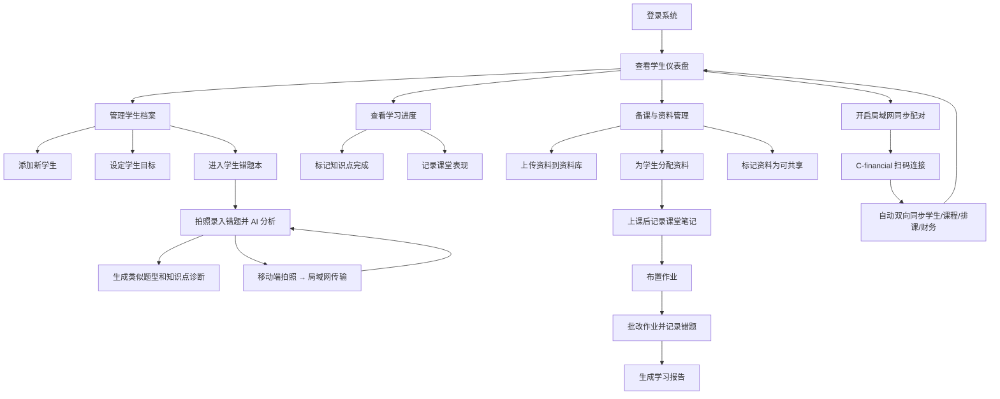

# C-teacher 产品需求文档

## 版本记录

| 版本 | 日期 | 变更内容 | 变更人 |
| --- | --- | --- | --- |
| v2.3.0 | 2026-07-02 | 新增局域网配对数据同步（REQ-022）：C-teacher 桌面端作为主设备，C-financial 配对后双向自动同步学生、课程、排课和财务字段。 | 用户需求分析 |
| v2.2.0 | 2026-06-26 | 资料库增强：新增 iCloud 自动同步（REQ-020）、拖拽上传（REQ-021）、iCloud 冲突处理策略、数据模型扩展。 | — |
| v2.1.2 | 2026-06-26 | 课堂记录类型化改造：类型选择从多选改为单选，更新接口、需求描述和页面设计。 | — |
| v2.1.1 | 2026-06-26 | 课堂记录类型化改造：类型选择从多选改为单选，更新接口、需求描述和页面设计。 | — |
| v2.1.0 | 2026-06-25 | 课堂记录类型化改造：8 种记录类型、动态表单字段、差异化状态流转、多选类型、按类型筛选。 | — |
| v2.0.0 | 2026-06-14 | 大合并：整合 PRD.before-*.md、资料库功能需求分析、移动端拍照传桌面端需求分析、错题本实施计划、资料库实施计划。新增模块 9（错题本）详细实现状态、模块 10（移动端拍照传桌面端）。版本记录移至文档顶部。 | — |
| v1.0.3 | 2026-05-30 | 补充学生错题本入口、按科目错题本、AI 拍照改题、错误分析、类似题生成与知识点分析。 | — |
| v1.0.2 | 2026-05-30 | 补充学生管理一级入口、多学科课程卡片、学生 CRUD、FTP/SMB 外部资料源连接。 | — |
| v1.0.1 | 2026-05-30 | 补充 macOS 优先支持、移动端支持、系统提醒调用要求。 | — |
| v1.0.0 | 2026-05-30 | 初始版本，由需求分析过程.md、功能模块.xlsx、需求记录.txt 整合生成。 | — |

> **合并来源文档**（已整合入本 PRD，原独立文件归档或删除）：  
> `PRD.before-student-management.md` (v1.0.1)、`PRD.before-mistakebook.md` (v1.0.2)、  
> `outputs/资料库功能需求分析.md`、`outputs/资料库实施计划.md`、  
> `outputs/移动端拍照传桌面端需求分析.md`、`outputs/移动端拍照传桌面端实施计划.md`、  
> `outputs/实施计划清单.md`（错题本）、`需求分析过程.md`、`需求记录.txt`

---

## 需求概述

### 背景

C-teacher 面向教师的一对多个性化教学管理场景，帮助教师管理学生档案、学习计划、课堂记录、教学资料、作业批改和阶段性学习反馈。

### 产品目标

- 建立以学生为中心的教学管理工作台。
- 支持教师按学生进度分配资料、记录课堂、跟踪作业和复盘学习效果。
- 通过资料复用、进度看板、报告生成和智能推荐，逐步降低重复备课与线下沟通成本。

### 目标用户

- 主要用户: 教师、教研人员、个人辅导老师。
- 间接用户: 学生、家长。

---

## 平台与系统能力

| 能力 | 阶段 | 优先级 | 是否 MVP | 描述 | 来源 |
| --- | --- | --- | --- | --- | --- |
| macOS 优先支持 | V1 | P0 | 是 | 产品优先面向 macOS 使用场景交付，教师端体验需优先适配 macOS 桌面环境。 | 用户补充 |
| 移动端支持 | V1 | P0 | 是 | 支持移动端访问核心功能，至少覆盖查看资料、查看学习计划、课堂记录查看、作业查看等轻量场景。 | 用户补充 |
| 系统提醒调用 | V1 | P0 | 是 | 支持调用系统提醒能力，用于课程、作业、批改、学习报告等关键事项提醒。 | 用户补充 |
| 移动端拍照传桌面端 | V2 | P0 | 否 | 手机拍照错题 → 局域网传输 → 桌面端自动入库 → AI 分析。复用 Go API sidecar。 | 用户补充 + 需求分析 |
| 局域网配对数据同步 | V2 | P0 | 否 | C-teacher 桌面端作为主设备，同 WiFi 下与 C-financial 配对后双向自动同步学生、课程、排课和财务字段。 | 用户需求分析 2026-07-02 |

> ⚠️ 待确认  
> - "系统提醒"具体指 macOS 通知中心、本机"提醒事项"App、日历提醒，还是跨端推送通知。当前 PRD 先按"可调用系统级提醒能力"描述，不限定具体技术实现。

---

## 路线图

| 阶段 | 范围 | 周期 | 包含需求 | 说明 | 来源 |
| --- | --- | --- | --- | --- | --- |
| V1 | MVP | 6 周 | P0 | 学生档案、学生错题本入口、个性化学习计划、课堂记录、资料库、资料-学生关联、macOS 优先教师端、移动端核心适配、系统提醒调用 | 需求记录.txt, 功能模块.xlsx, 需求分析过程.md, 用户补充 |
| V2 | 增强版 | 4 周 | P1 | 资料共享与复用、进度看板、作业与批改跟踪、错题本 AI 分析、资料打标签/搜索、移动端拍照传桌面端、**课堂记录类型化**、局域网配对数据同步 | 需求记录.txt, 需求分析过程.md, 用户补充 |
| V3 | 智能化 | 6 周 | P1 + P2 | 学习报告自动生成、智能备课推荐、学生自助端、知识点图谱、跨知识点错因洞察 | 需求记录.txt, 需求分析过程.md, 用户补充 |

> ⚠️ 待确认  
> - `功能模块.xlsx` 将"资料库: 上传/存储/分类/标签"列入 MVP；`需求记录.txt` 将"资料打标签/搜索"列入 V2。当前 PRD 将基础分类归入 MVP，将标签/搜索能力标记为 V2，需确认最终边界。
> - `功能模块.xlsx` 将"多学生分配"列入 MVP；`需求记录.txt` 将"资料共享与复用（多选分配）"列入 V2。当前 PRD 将基础单学生资料分配归入 MVP，将多选/复用/推荐能力标记为 V2，需确认最终边界。

---

## 功能模块

### 模块 1: 学生管理

| 功能 ID | 功能 | 阶段 | 优先级 | 是否 MVP | 描述 | 来源 |
| --- | --- | --- | --- | --- | --- | --- |
| REQ-001 | 学生档案管理 | V1 | P0 | 是 | 创建、编辑、查看、删除学生基本信息、学习目标、起始水平；学生以卡片形式展示课程信息，且一个学生可关联多个学科。 | 需求分析过程.md, 用户补充 |
| REQ-017 | 学生错题本入口 | V1 | P0 | 是 | 一个学生对应一个错题本，错题本按科目组织；不作为一级菜单，在学生管理卡片和学生概览中提供显眼入口。 | 用户补充 |
| REQ-018 | AI 错题分析与练习生成 | V2 | P1 | 否 | 接入 AI 模型，支持拍照识别错题、辅助改题、错误原因分析、相似题生成和知识点掌握分析。 | 用户补充 |

### 模块 2: 个性化学习计划

| 功能 ID | 功能 | 阶段 | 优先级 | 是否 MVP | 描述 | 来源 |
| --- | --- | --- | --- | --- | --- | --- |
| REQ-002 | 个性化学习计划 | V1 | P0 | 是 | 为每个学生设定独立课程大纲、课时安排和学习目标。 | 需求分析过程.md |
| REQ-011 | 知识点图谱 | V3 | P2 | 否 | 建立学科知识图谱，可视化每个学生的知识掌握情况和薄弱环节。 | 需求分析过程.md |

### 模块 3: 课堂记录

> #### 3.1 课堂记录类型化（REQ-019）

**功能概述**：在现有课堂记录基础上引入类型化概念，支持 8 种记录类型，不同类型录入字段、状态流转差异化处理，支持按类型筛选。

**交互方式**：选择类型后，表单动态切换，只显示该类型相关字段（保留已填数据，切换回来时恢复）。

**单选类型**：类型选择为单选，一条记录只属于一种类型（如"课堂讲授"或"课后作业"）。

**列表展示**：用标签（Tag）展示类型，支持按类型、状态、批改状态组合筛选。

#### 3.1.1 数据模型

```typescript
export type RecordType =
  | "课堂讲授" | "课堂练习" | "课后作业" | "实验报告"
  | "测验考试" | "项目任务" | "辅导记录" | "复习笔记";

export type RecordStatus =
  | "已记录" | "已完成"                        // 课堂讲授
  | "待完成" | "已完成" | "待批改" | "已批改"   // 课堂练习
  | "待提交" | "已提交" | "待批改" | "已批改"   // 课后作业
  | "未提交" | "已提交" | "已批改" | "已点评"   // 实验报告
  | "未考试" | "已考试" | "待批改" | "已批改" | "已讲评"  // 测验考试
  | "进行中" | "已提交" | "待批改" | "已批改"   // 项目任务
  | "已预约" | "已完成" | "待跟进" | "已跟进"   // 辅导记录
  | "未整理" | "已整理" | "已复习";             // 复习笔记

export type ClassRecord = {
  id: string;
  studentId: string;
  subjects: string[];              // 改为数组，支持多科目
  recordType: RecordType;        // 新增：记录类型（单选）
  // --- 通用字段 ---
  lessonContent: string;           // 授课内容/主题（必填）
  performance: string;             // 课堂表现（可选）
  attachments: string[];           // 附件（图片/文件 ID）
  notes: string;                   // 备注
  // --- 类型特有字段 ---
  // [课堂讲授][课堂练习][课后作业][复习笔记]
  knowledgePoints: string[];       // 知识点
  duration: number;                // 时长（分钟）
  // [课堂练习][课后作业][实验报告][测验考试][项目任务]
  practiceContent: string;         // 练习内容/题目
  completionStatus: string;        // 完成情况
  // [课后作业][项目任务]
  deadline: string;                // 截止日期（ISO）
  // [实验报告]
  experimentName: string;          // 实验名称
  experimentTools: string;         // 实验器材
  experimentConclusion: string;    // 实验结论
  // [测验考试]
  testName: string;                // 测验名称
  testScore: number;               // 得分
  testTotal: number;               // 总分
  testErrors: string;              // 错题记录
  // [项目任务]
  projectName: string;             // 项目名称
  projectDescription: string;      // 任务描述
  projectProgress: number;         // 进度（%）
  // [辅导记录]
  tutoringTopic: string;           // 辅导主题
  tutoringFocus: string;           // 辅导重点
  tutoringDuration: number;        // 辅导时长（分钟）
  followUpPlan: string;            // 下次计划
  // [复习笔记]
  reviewTopic: string;             // 复习主题
  reviewContent: string;           // 复习内容
  // --- 公共字段 ---
  status: RecordStatus;            // 新增：状态（根据类型自动设置）
  gradingStatus: GradingStatus;    // 保留：批改状态
  createdAt: string;
  updatedAt: string;
};
```

#### 3.1.2 状态流转规则

| 类型 | 状态流转 | 初始状态 | 自动流转条件 |
|------|----------|----------|--------------|
| 课堂讲授 | 已记录 → 已完成 | 已记录 | 标记完成时自动流转 |
| 课堂练习 | 待完成 → 已完成 → 待批改 → 已批改 | 待完成 | 提交→已完成，批改→已批改 |
| 课后作业 | 待提交 → 已提交 → 待批改 → 已批改 | 待提交 | 提交→已提交，批改→已批改 |
| 实验报告 | 未提交 → 已提交 → 已批改 → 已点评 | 未提交 | 提交→已提交，批改→已批改，点评→已点评 |
| 测验考试 | 未考试 → 已考试 → 待批改 → 已批改 → 已讲评 | 未考试 | 考试→已考试，批改→待批改，批改→已批改，讲评→已讲评 |
| 项目任务 | 进行中 → 已提交 → 待批改 → 已批改 | 进行中 | 提交→已提交，批改→待批改，批改→已批改 |
| 辅导记录 | 已预约 → 已完成 → 待跟进 → 已跟进 | 已预约 | 完成→已完成，跟进→已跟进 |
| 复习笔记 | 未整理 → 已整理 → 已复习 | 未整理 | 整理→已整理，复习→已复习 |

#### 3.1.3 各类型必填字段

> `✅` = 可见字段，`(必填)` = 保存时校验必填，`(可选)` = 可选填

| 字段 | 课堂讲授 | 课堂练习 | 课后作业 | 实验报告 | 测验考试 | 项目任务 | 辅导记录 | 复习笔记 |
|------|:---:|:---:|:---:|:---:|:---:|:---:|:---:|:---:|
| 学生（必填） | ✅ | ✅ | ✅ | ✅ | ✅ | ✅ | ✅ | ✅ |
| 科目（必填） | ✅ | ✅ | ✅ | ✅ | ✅ | ✅ | | ✅ |
| 授课内容/主题（必填） | ✅ | ✅ | ✅ | ✅ | ✅ | ✅ | ✅ | ✅ |
| 知识点 | ✅ | ✅ | ✅ | | | ✅ | | |
| 时长（分钟） | ✅ | ✅ | | | | | ✅ | |
| 练习内容/题目（必填） | | ✅ | ✅ | | | | | |
| 完成情况（必填） | | ✅ | ✅ | ✅ | | | | ✅ |
| 得分 | | | | | ✅ | | | |
| 总分 | | | | | ✅ | | | |
| 实验名称（必填） | | | | ✅ | | | | |
| 实验器材（必填） | | | | ✅ | | | | |
| 实验结论 | | | | ✅ | | | | |
| 测验名称（必填） | | | | | ✅ | | | |
| 考试时间（必填） | | | | | ✅ | | | |
| 错题记录 | | | | | ✅ | | | |
| 项目名称（必填） | | | | | | ✅ | | |
| 任务描述（必填） | | | | | | ✅ | | |
| 进度（必填） | | | | | | ✅ | | |
| 截止日期（必填） | | | ✅ | | | ✅ | | |
| 辅导主题（必填） | | | | | | | ✅ | |
| 辅导重点（必填） | | | | | | | ✅ | |
| 辅导时长 | | | | | | | ✅ | |
| 下次计划 | | | | | | | ✅ | |
| 复习内容（必填） | | | | | | | | ✅ |
| 课堂表现 | ✅ | ✅ | ✅ | ✅ | ✅ | ✅ | ✅ | ✅ |
| 附件 | ✅ | ✅ | ✅ | ✅ | ✅ | ✅ | | |
| 备注 | ✅ | ✅ | ✅ | ✅ | ✅ | ✅ | ✅ | ✅ |

#### 3.1.4 录入表单交互

- **类型选择器**：单选下拉选择，点击切换选中状态
- **动态表单**：选择类型后，下方字段区域即时刷新，只显示选中类型需要的字段
- **数据保留**：已填写内容后切换类型，保留已填数据，切换回来时恢复
- **必填校验**：保存时校验所有可见字段的必填项，缺失则阻止提交并提示
- **编辑已有记录**：允许修改类型，缺失字段留空并提示补充，否则提交失败

#### 3.1.5 列表展示

- **类型标签**：每条记录用 Tag 展示类型，如 `课堂讲授`
- **筛选栏**：
  - 类型筛选：单选下拉，可选一个类型
  - 状态筛选：按各类型对应的状态过滤
  - 批改状态筛选：待批改 / 已批改 / 全部
  - 组合筛选：三种筛器可同时生效

#### 3.1.6 向后兼容

- 已有课堂记录自动标记为 `"课堂讲授"` 类型
- 已有记录的 `status` 默认为 `"已记录"`
- 已有记录的 `gradingStatus` 保持不变
- 列表展示时，已有记录默认显示为"课堂讲授"类型标签

#### 3.1.7 数据库变更

```sql
ALTER TABLE class_records ADD COLUMN record_type TEXT NOT NULL DEFAULT '课堂讲授';
ALTER TABLE class_records ADD COLUMN status TEXT NOT NULL DEFAULT '已记录';
ALTER TABLE class_records ADD COLUMN knowledge_points TEXT NOT NULL DEFAULT '[]';
ALTER TABLE class_records ADD COLUMN duration INTEGER NOT NULL DEFAULT 0;
ALTER TABLE class_records ADD COLUMN practice_content TEXT NOT NULL DEFAULT '';
ALTER TABLE class_records ADD COLUMN completion_status TEXT NOT NULL DEFAULT '';
ALTER TABLE class_records ADD COLUMN experiment_name TEXT NOT NULL DEFAULT '';
ALTER TABLE class_records ADD COLUMN experiment_tools TEXT NOT NULL DEFAULT '';
ALTER TABLE class_records ADD COLUMN experiment_conclusion TEXT NOT NULL DEFAULT '';
ALTER TABLE class_records ADD COLUMN test_name TEXT NOT NULL DEFAULT '';
ALTER TABLE class_records ADD COLUMN test_score INTEGER NOT NULL DEFAULT 0;
ALTER TABLE class_records ADD COLUMN test_total INTEGER NOT NULL DEFAULT 0;
ALTER TABLE class_records ADD COLUMN test_errors TEXT NOT NULL DEFAULT '';
ALTER TABLE class_records ADD COLUMN project_name TEXT NOT NULL DEFAULT '';
ALTER TABLE class_records ADD COLUMN project_description TEXT NOT NULL DEFAULT '';
ALTER TABLE class_records ADD COLUMN project_progress INTEGER NOT NULL DEFAULT 0;
ALTER TABLE class_records ADD COLUMN deadline TEXT NOT NULL DEFAULT '';
ALTER TABLE class_records ADD COLUMN tutoring_topic TEXT NOT NULL DEFAULT '';
ALTER TABLE class_records ADD COLUMN tutoring_focus TEXT NOT NULL DEFAULT '';
ALTER TABLE class_records ADD COLUMN tutoring_duration INTEGER NOT NULL DEFAULT 0;
ALTER TABLE class_records ADD COLUMN follow_up_plan TEXT NOT NULL DEFAULT '';
ALTER TABLE class_records ADD COLUMN review_topic TEXT NOT NULL DEFAULT '';
ALTER TABLE class_records ADD COLUMN review_content TEXT NOT NULL DEFAULT '';
ALTER TABLE class_records ADD COLUMN attachments TEXT NOT NULL DEFAULT '[]';
ALTER TABLE class_records ADD COLUMN subjects TEXT NOT NULL DEFAULT '';  -- JSON 数组
```

#### 3.1.8 涉及变更的文件

| 文件 | 变更类型 | 说明 |
|------|----------|------|
| `childStore.ts` | 修改 | 数据类型扩展、状态流转逻辑、normalizeClassRecord 增强 |
| `ClassRecordPage.vue` | 修改 | 动态表单字段、类型单选、筛选栏、列表标签展示 |
| `lib.rs` | 修改 | SQLite 表结构 ALTER TABLE |
| `DashboardPage.vue` | 修改 | 按类型分别统计待批改数量 |
| `LearningReportPage.vue` | 修改 | 报告按类型分类展示 |
| `CalendarPlanItem` 相关 | 修改 | 日历中显示类型标签 |
| `PRD.md` | 修改 | 实体 3 课堂记录字段定义更新 |
| REQ-019 | 课堂记录类型化 | V2 | P1 | 否 | 课堂记录区分 8 种类型（课堂讲授/课堂练习/课后作业/实验报告/测验考试/项目任务/辅导记录/复习笔记），不同类型录入字段差异化处理，支持单选类型和按类型筛选。 | 用户需求分析 2026-06-25 |

### 模块 4: 资料库与资料分配

| 功能 ID | 功能 | 阶段 | 优先级 | 是否 MVP | 描述 | 来源 |
| --- | --- | --- | --- | --- | --- | --- |
| REQ-004 | 资料库管理 | V1 | P0 | 是 | 上传、分类、存储教学资料，支持 PDF、图片、视频、文档等类型。 | 需求分析过程.md, 功能模块.xlsx |
| REQ-005 | 资料-学生关联 | V1 | P0 | 是 | 将资料与学生绑定，学生只能看到自己分配的资料。 | 需求分析过程.md |
| REQ-006 | 资料共享与复用 | V2 | P1 | 否 | 标记资料为可共享，并推荐给进度相近的学生，减少重复备课。 | 需求分析过程.md, 需求记录.txt |
| REQ-010 | 智能备课推荐 | V3 | P1 | 否 | 基于学生当前进度和薄弱点，推荐合适的教学资料。 | 需求分析过程.md |
| REQ-016 | 外部共享资料连接 | V1 | P0 | 是 | 学习资料支持连接 FTP、SMB 等共享协议，用于从外部共享目录导入或引用教学资料。 | 用户补充 |
| REQ-020 | iCloud 自动同步 | V1 | P0 | 是 | 标记为「可共享」的资料自动同步到 iCloud Drive，支持多设备访问。冲突处理：同一文件本地和 iCloud 都有修改时，保留最新修改版本。 | 用户需求分析 2026-06-26 |
| REQ-021 | 拖拽上传 | V1 | P0 | 是 | 支持拖拽文件到应用窗口直接上传，沿用现有 14 种格式支持（PDF、图片、视频、文档等），上传后自动归入资料库。 | 用户需求分析 2026-06-26 |

#### 4.1 资料库当前实现状态

> 来源: `outputs/资料库功能需求分析.md` (2026-06-13)

**已完整实现**：上传本地文件（14 种格式）、资料 CRUD（增删改查）、单/多学生分配、FTP 外部连接、本地目录递归扫描导入（深度 3，上限 500）、资料删除（含确认对话框）、调用 OS 默认程序打开文件。

**部分实现**：
- 标签管理：仅逗号分隔输入，无独立标签管理页面
- 搜索筛选：仅关键词搜索，缺分类/标签/文件类型筛选器
- 学生资料视图：仅文本列表，无独立页面
- SMB 连接：仅传递给 OS 打开，无 SMB 协议实现
- 连接测试：仅检查字段存在性，非真实连接测试

**未实现**：资料按分类/标签分组浏览、标记可共享（`shareable` 字段，iCloud 同步前置条件）、iCloud 自动同步、拖拽上传、智能推荐、资料预览缩略图。

#### 4.2 资料库待改进功能

**P0 — 核心体验（5 天）**：

| # | 功能 | 改进方案 |
|---|------|----------|
| 1 | 三维筛选器 | 分类下拉 + 标签筛选 + 文件类型筛选 + 重置按钮 |
| 2 | 资料预览 | 图片/PDF 缩略图预览，弹窗预览不离开页面 |
| 3 | 批量操作 | 多选 checkbox + 批量分配学生/批量删除/批量分类 |
| 4 | 拖拽上传 | 支持拖拽文件到页面直接上传，沿用现有 14 种格式 |

**P1 — 效率提升（5 天）**：

| # | 功能 | 改进方案 |
|---|------|----------|
| 5 | 资料详情弹窗 | 元数据 + 预览 + 分配历史 + 标签管理 |
| 6 | 标签管理增强 | 独立标签管理，自动补全，标签统计 |
| 7 | 排序功能 | 按名称/日期/分类/大小排序 |
| 8 | 虚拟文件夹 | 创建虚拟文件夹组织资料 |

**P1.5 — iCloud 同步（3 天）**：

| # | 功能 | 改进方案 |
|---|------|----------|
| 9 | iCloud Drive 集成 | 使用 NSFileManager ubiquity API，标记「可共享」的资料自动同步到 iCloud Drive |
| 10 | 同步状态管理 | 同步进度、成功/失败状态、同步日志 |
| 11 | 冲突处理 | 同一文件本地和 iCloud 都有修改时，保留最新修改版本 |

**P2 — 增强功能（10 天）**：

| # | 功能 | 改进方案 |
|---|------|----------|
| 12 | SMB 真实连接 | 实现 SMB 协议（smb2 库） |
| 13 | 连接测试增强 | FTP/SMB 真实连接测试 |
| 14 | 资料同步状态 | 定时同步、增量同步、同步日志 |
| 15 | 版本管理 | 文件版本追踪、历史版本查看 |
| 16 | 使用统计 | 查看次数、最近使用、学生使用率 |

**后端增强**：资料元数据自动提取（PDF 页数/图片尺寸/视频时长）、缩略图生成（后端缓存）、FTS5 全文搜索（含中文分词）。

**与错题本完成度对比**：资料库 UI 完成度中等（列表+表单，缺筛选/预览），错题本 UI 完成度高（卡片+弹窗+统计+导出）。资料库在筛选能力、标签系统、导出能力、统计看板方面均有提升空间。

#### 4.3 资料库实施计划

**Phase 1: 核心体验补足（P0, 5 天）**
1. 分类/标签/文件类型三维筛选器 (`MaterialLibraryPage.vue`)
2. 图片/PDF 缩略图预览 (`MaterialLibraryPage.vue` + `lib.rs` 新增 `generate_material_thumbnail` command)
3. 多选批量操作 — 资料卡片 checkbox + 顶部批量操作栏
4. 拖拽上传 — `MaterialLibraryPage.vue` 添加 dragover/drop 事件处理 + 上传逻辑

**Phase 2: 效率提升（P1, 5 天）**
5. 资料详情弹窗、6. 标签管理增强、7. 排序、8. 虚拟文件夹

**Phase 2.5: iCloud 同步（P1.5, 3 天）**
9. iCloud Drive 集成 — NSFileManager ubiquity API (`lib.rs` 新增 iCloud 相关 Tauri commands)
10. 同步状态管理 — 同步进度/状态/日志 UI
11. 冲突处理 — 最新修改优先策略实现

**Phase 3: 增强功能（P2, 按需）**
12-16. SMB 协议、连接测试、同步管理、版本管理、使用统计

### 模块 5: 进度与作业跟踪

| 功能 ID | 功能 | 阶段 | 优先级 | 是否 MVP | 描述 | 来源 |
| --- | --- | --- | --- | --- | --- | --- |
| REQ-007 | 进度看板 | V2 | P1 | 否 | 可视化展示所有学生的学习进度，如已完成、进行中、待开始知识点。 | 需求分析过程.md |
| REQ-008 | 作业与批改跟踪 | V2 | P1 | 否 | 在线布置作业，记录批改状态和错题集。 | 需求分析过程.md |

### 模块 6: 提醒与日程

| 功能 ID | 功能 | 阶段 | 优先级 | 是否 MVP | 描述 | 来源 |
| --- | --- | --- | --- | --- | --- | --- |
| REQ-015 | 系统提醒调用 | V1 | P0 | 是 | 支持为课程、作业、批改、学习报告等关键事项创建系统提醒。 | 用户补充 |

### 模块 7: 报告与学生端

| 功能 ID | 功能 | 阶段 | 优先级 | 是否 MVP | 描述 | 来源 |
| --- | --- | --- | --- | --- | --- | --- |
| REQ-009 | 学习报告自动生成 | V3 | P1 | 否 | 按周/月生成学生学习报告，包含掌握率、学习时长、进步曲线。 | 需求分析过程.md |
| REQ-014 | 学生自助端（小程序） | V3 | P2 | 否 | 学生可查看资料、提交作业、查看学习报告。 | 需求分析过程.md |

### 模块 8: 排课

| 功能 ID | 功能 | 阶段 | 优先级 | 是否 MVP | 描述 | 来源 |
| --- | --- | --- | --- | --- | --- | --- |
| REQ-012 | 智能排课助手 | V3 | P2 | 否 | 结合学生空闲时间和教师日程，自动推荐排课方案。 | 需求分析过程.md |

### 模块 9: 学生错题本（详细）

> 来源: `outputs/实施计划清单.md` (2026-06-13)，26/26 项功能全部完成。

#### 9.1 功能需求

| 功能 ID | 功能 | 阶段 | 优先级 | 是否 MVP | 描述 |
| --- | --- | --- | --- | --- | --- |
| REQ-017 | 错题本入口 | V1 | P0 | 是 | 学生卡片显眼入口 + 按科目错题概览 |
| REQ-018 | AI 错题分析 | V2 | P1 | 否 | 拍照识别错题、错误原因分析、相似题生成、知识点掌握分析 |

#### 9.2 当前实现状态（全部完成 ✅）

**数据基础层 (P0)**：
- `mistake_records` 表 — 18 字段完整表 (`lib.rs`)
- `mistake_tags` 表 — 3 个 CRUD commands + 40+ K12 标签种子数据（9 学科）
- `MistakeRecord` / `MistakeTag` TypeScript 类型定义 (`studentStore.ts`)
- 8 个 Tauri CRUD Commands（增删改查 + 批量掌握状态更新）
- 错题卡片列表 UI（`MistakeCardList.vue` 276 行）+ 错题本主页面（`MistakeBookPage.vue` 853 行）
- 错题详情弹窗（`MistakeDetailModal.vue` 620 行）
- AI 分析结果自动入库（`MistakeBookPage.vue:178-188`）

**核心交互层 (P1)**：
- 标签自动补全（`MistakeDetailModal.vue` NSelect + tagSuggestions）
- AI 标签自动入库（knowledgePoints 自动写入 tags）
- 多维度筛选栏 — 科目/状态/难度/关键词 四维
- 掌握状态切换 — 待复习/已掌握/需加强 三态
- 类似题难度分级 — `mistakeApi.ts` DIFFICULTY_INSTRUCTIONS + count 参数
- 薄弱点自动聚合 — activeStudentMistakeStats computed

**差异化竞争力 (P2)**：
- 导出打印 — `mistakeExport.ts` 生成打印版 HTML + window.print()
- 导出内容选项 — 答案/解析/知识点/图片/缩放比例
- 统计看板 — `MistakeStatsDashboard.vue` 环形图+柱状图+趋势图+知识点排行
- 图片裁剪 — `ImageCropper.vue` Canvas 拖拽裁剪 + 预览

**体验增强 (P3)**：
- LaTeX 公式渲染 — `contentFormatter.ts` 50+ LaTeX 符号 + 上下标 + 分数
- Markdown 渲染 — 标题/加粗/斜体/列表/引用/代码
- 批量导入错题 — `BatchImportModal.vue` 多图选择 + 进度条 + 逐张分析
- 错题复习模式 — `ReviewMode.vue` 随机抽题/薄弱优先 + 闪卡翻转

**筛选增强 (P2)**：
- 按知识点筛选、按时间范围筛选（7/30/90/本年）、按年级筛选（12 个年级）、按学期筛选

**标签管理 (P2)**：
- `TagManageModal.vue` — 增删改查、分类筛选、搜索、K12 标签种子数据

#### 9.3 错题本文件清单

| 文件 | 行数 | 功能 |
|------|------|------|
| `MistakeBookPage.vue` | 853 | 错题本完整页面 |
| `MistakeCardList.vue` | 276 | 错题卡片列表（四维筛选） |
| `MistakeDetailModal.vue` | 620 | 错题详情弹窗 |
| `MistakeStatsDashboard.vue` | 230 | 统计看板 |
| `ImageCropper.vue` | 180 | 图片裁剪 |
| `BatchImportModal.vue` | 210 | 批量导入 |
| `ReviewMode.vue` | 200 | 复习模式 |
| `MistakeDetailView.vue` | — | 错题详情独立页 |
| `TagManageModal.vue` | 200 | 标签管理弹窗 |
| `mistakeExport.ts` | 180 | 导出打印工具 |
| `contentFormatter.ts` | 110 | LaTeX/Markdown 渲染 |
| `mistakeApi.ts` | — | AI 分析 API 封装 |

### 模块 10: 移动端拍照传桌面端（新需求）

> 来源: `outputs/移动端拍照传桌面端需求分析.md` + `outputs/移动端拍照传桌面端实施计划.md` (2026-06-13)

#### 10.1 需求概述

教师使用手机拍摄学生错题，照片通过局域网传输到桌面端 C-teacher 应用进行 AI 分析。当前桌面端仅支持本地文件选择器选图，无法接收移动端照片。

**核心流程**：`手机拍照 → 传输到桌面端 → 自动入库 → AI 分析 → 教师确认`

#### 10.2 技术方案（推荐方案 A）

**方案 A: Go API 扩展 + 移动端 Web（推荐）**

```
手机浏览器
    │ getUserMedia 拍照 / <input capture>
    ▼ multipart/form-data 上传
Go API Server (桌面端 :18080, Tauri sidecar 自动管理)
    │ POST /v1/upload/image → 保存到 ~/.c-teacher/uploads/
    ▼ WebSocket /ws/uploads 推送通知
桌面端 Tauri App
    │ 自动加载新图片 + 填入 AI 分析表单
    ▼
教师确认 → 错题入库
```

**选型理由**：开发量最小，复用现有 Go API sidecar，无需原生移动端开发。

**备选方案**：
- 方案 B: Tauri Mobile 原生 — 原生体验好但开发量大，需处理签名/分发
- 方案 C: 微信小程序 + Go API — 微信生态覆盖广但需审核流程

#### 10.3 功能清单

**P0 — 核心功能（4.5 天）**：

| # | 功能 | 工作量 | 说明 |
|---|------|--------|------|
| 1 | Go API 文件上传端点 | 1 天 | `POST /v1/upload/image` 接收 multipart 图片（max 8MB） |
| 2 | 桌面端图片接收通知 | 1 天 | WebSocket `/ws/uploads` 或轮询 `GET /v1/uploads/recent` |
| 3 | 移动端拍照 Web 页面 | 2 天 | 响应式页面，`getUserMedia` + `<input capture>` 降级 |
| 4 | 图片自动入库 | 0.5 天 | 上传后自动创建错题记录草稿 |

**P1 — 体验优化（3 天）**：

| # | 功能 | 工作量 | 说明 |
|---|------|--------|------|
| 5 | 局域网 IP 发现 + QR 码 | 1 天 | 桌面端显示本机 IP + 二维码，手机扫码连接 |
| 6 | 移动端图片压缩 | 0.5 天 | 上传前压缩，减少传输时间 |
| 7 | 上传进度反馈 | 0.5 天 | 进度条 + 成功/失败提示 |
| 8 | 批量拍照 | 1 天 | 连续拍多张，批量上传 |

**P2 — 增强功能（3.5 天）**：

| # | 功能 | 工作量 | 说明 |
|---|------|--------|------|
| 9 | WebSocket 实时推送 | 1 天 | 替代轮询 |
| 10 | 图片预览确认弹窗 | 1 天 | 上传后桌面端弹窗预览 |
| 11 | 自动关联学生/科目 | 1 天 | 根据时间段/科目自动关联 |
| 12 | 上传历史记录 | 0.5 天 | 移动端查看已上传图片 |

#### 10.4 接口设计

**文件上传端点**：

```
POST /v1/upload/image
Content-Type: multipart/form-data

字段:
  - file: 图片文件 (png/jpg/jpeg/webp, max 8MB)
  - studentId: 可选，关联学生 ID
  - subject: 可选，科目

响应: { "id", "path", "size", "createdAt" }
```

**WebSocket 通知**：

```
ws://127.0.0.1:18080/ws/uploads
消息: { "type": "new_upload", "id", "path", "studentId", "subject" }
```

#### 10.5 安全考虑

| 风险 | 措施 |
|------|------|
| 未授权上传 | 一次性 token，手机扫码获取 |
| 图片大小 | 服务端 8MB 限制 + 客户端压缩 |
| 局域网暴露 | 仅监听 127.0.0.1 或特定网卡 |
| 临时文件 | 定期清理 `~/.c-teacher/uploads/` |

#### 10.6 实施计划

**Phase 1: 核心链路（P0, 4.5 天）**
1. Go API 文件上传端点 (`services/api/cmd/server/upload.go`)
2. 桌面端 WebSocket 通知 (`services/api/cmd/server/websocket.go`)
3. 移动端拍照 Web 页面 (`services/api/cmd/server/mobile.html`)
4. 桌面端接收集成 (`MobileConnectModal.vue` + `MistakeBookPage.vue` 改动)

**Phase 2: 体验优化（P1, 3 天）**
5. 局域网 IP 发现 + QR 码、6. 图片压缩、7. 进度反馈、8. 批量拍照

**Phase 3: 增强（P2, 按需）**
9-12. WebSocket、预览确认、自动关联、历史记录

**新增文件**：`upload.go`、`websocket.go`、`mobile.html`、`MobileConnectModal.vue`
**修改文件**：`main.go`（路由注册）、`MistakeBookPage.vue`（接收上传）、`lib.rs`（`save_uploaded_image` command）

### 模块 11: 局域网配对数据同步（REQ-022）

> 来源: 用户需求分析 2026-07-02

#### 11.1 需求概述

C-teacher 与 C-financial 在同一个 WiFi 下，通过双方配对建立可信连接。C-teacher 桌面端作为主设备，C-financial 作为配对设备；配对成功后自动进行双向数据同步，范围限定为学生、课程、排课和财务相关字段，不同步错题图片、教学资料文件、PDF 费用单等大文件。

**核心流程**：`桌面端开启配对 → C-financial 扫码/输入配对码 → 双方确认连接 → 自动双向同步 → 展示同步结果`

#### 11.2 同步范围

| 数据类别 | 同步方向 | 字段归属 | 说明 |
| --- | --- | --- | --- |
| 学生基础信息 | 双向 | 共享字段人工处理冲突 | `id/name/gender/guardianPhone/address` 等基础字段保持一致 |
| 教学字段 | C-teacher 优先 | C-teacher | `goal/style/materials/mistakeBook` 等教学侧字段由 C-teacher 主维护 |
| 课程信息 | 双向 | 共享字段人工处理冲突 | `Course/CourseLesson/CourseSchedule` 结构保持一致 |
| 排课信息 | 双向 | 共享字段人工处理冲突 | `ScheduledLesson` 与 C-financial 排课结构按课程、学生和时间同步 |
| 课程-学生关联 | 双向 | 共享字段人工处理冲突 | `{ courseId, studentId, currentLesson, progress }` 保持一致 |
| 财务字段 | C-financial 优先 | C-financial | `totalHours/completedHours/collectionMode/paymentStatus` 由 C-financial 主维护 |

**不在 MVP 范围**：错题图片、资料库文件、iCloud 文件、PDF 费用单、账号权限、跨互联网远程同步、多人实时协作。

#### 11.3 配对管理

| 功能 ID | 功能 | 阶段 | 优先级 | 是否 MVP | 描述 |
| --- | --- | --- | --- | --- | --- |
| REQ-022-1 | 开启桌面端配对 | V2 | P0 | 是 | C-teacher 桌面端打开本地同步服务，生成二维码和配对码。 |
| REQ-022-2 | C-financial 发起连接 | V2 | P0 | 是 | C-financial 扫描二维码或输入配对码，连接同 WiFi 下的 C-teacher。 |
| REQ-022-3 | 双方确认配对 | V2 | P0 | 是 | 桌面端展示待配对设备名称、IP 和时间，用户确认后建立可信连接。 |
| REQ-022-4 | 设备管理 | V2 | P1 | 否 | 查看已配对设备、最近同步时间、解除配对。 |

**配对信息建议包含**：`host/ip/port/sessionId/oneTimeToken/expiresAt/schemaVersion/deviceName`。一次性 token 默认 5 分钟有效，配对完成后换取长期设备授权。

#### 11.4 自动同步

| 功能 ID | 功能 | 阶段 | 优先级 | 是否 MVP | 描述 |
| --- | --- | --- | --- | --- | --- |
| REQ-022-5 | 连接后自动同步 | V2 | P0 | 是 | 配对连接成功后立即执行一次双向增量同步。 |
| REQ-022-6 | 增量变更同步 | V2 | P0 | 是 | 按实体 `updatedAt/deletedAt/schemaVersion` 识别新增、更新和删除。 |
| REQ-022-7 | 同步状态提示 | V2 | P0 | 是 | 展示同步中、同步成功、同步失败、冲突待处理等状态。 |
| REQ-022-8 | 失败重试 | V2 | P1 | 否 | WiFi 中断、设备休眠、端口不可达时允许手动重试。 |

**自动同步触发条件**：

- 首次配对成功后自动同步。
- 已配对设备重新连接成功后自动同步。
- 自动同步只在同 WiFi 且设备授权有效时触发。
- 同步前校验双方 schema 版本，不兼容时阻止同步并提示升级。

#### 11.5 冲突处理

| 冲突类型 | 默认策略 | 用户处理 |
| --- | --- | --- |
| 教学字段冲突 | 保留 C-teacher | 无需用户处理，记录同步日志 |
| 财务字段冲突 | 保留 C-financial | 无需用户处理，记录同步日志 |
| 共享字段冲突 | 暂停该字段合并 | 展示双方值，由用户选择保留 C-teacher 或 C-financial |
| 删除冲突 | 删除优先级低于更新 | 用户确认删除或恢复 |

共享字段包括学生姓名、性别、家长电话、地址、课程名称、科目、课时标题、排课时间等双方都会直接编辑的字段。

#### 11.6 接口设计（草案）

```
GET /v1/sync/pairing/session
响应: { sessionId, oneTimeToken, host, port, expiresAt, schemaVersion, deviceName }

POST /v1/sync/pairing/confirm
请求: { sessionId, deviceId, deviceName, oneTimeToken }
响应: { pairingId, deviceToken, acceptedAt }

POST /v1/sync/pull
请求: { deviceId, deviceToken, since, entityTypes }
响应: { schemaVersion, changes, serverTime }

POST /v1/sync/push
请求: { deviceId, deviceToken, changes }
响应: { accepted, conflicts, serverTime }

GET /v1/sync/status
响应: { connectedDevices, lastSyncAt, lastError, pendingConflicts }
```

#### 11.7 验收标准

- [ ] C-teacher 桌面端可生成二维码和配对码。
- [ ] C-financial 在同 WiFi 下扫码或输入配对码后可连接 C-teacher。
- [ ] C-teacher 端确认后，双方自动完成一次双向同步。
- [ ] 学生、课程、排课和财务字段按同步范围保持一致。
- [ ] 教学字段冲突时默认保留 C-teacher，财务字段冲突时默认保留 C-financial。
- [ ] 共享字段冲突时不自动覆盖，必须展示双方值并等待用户选择。
- [ ] 不同步错题图片、资料文件、PDF 费用单等大文件。
- [ ] WiFi 断开或 token 过期时，同步失败并给出可理解提示。

---

## MVP 范围

### MVP 功能清单

| 模块 | MVP 功能 | 预估工时 | 来源 |
| --- | --- | --- | --- |
| 学生管理 | 学生 CRUD + 基本信息 + 多学科课程卡片 | 1 周 | 功能模块.xlsx, 用户补充 |
| 学生错题本入口 | 学生卡片显眼入口 + 按科目错题概览 | 待估 | 用户补充 |
| 个性化学习计划 | 知识点拆解 + 状态管理 | 2 周 | 功能模块.xlsx |
| 课堂记录 | 新增/查看/编辑记录 | 1 周 | 功能模块.xlsx |
| 资料库 | 上传/存储/分类 | 2 周 | 功能模块.xlsx |
| 外部共享资料连接 | FTP/SMB 等共享协议连接 | 待估 | 用户补充 |
| 资料分配 | 单学生资料分配 | 2 周 | 功能模块.xlsx |
| macOS 优先支持 | 教师端优先适配 macOS 桌面环境 | 待估 | 用户补充 |
| 移动端支持 | 移动端核心功能查看与轻量操作 | 待估 | 用户补充 |
| 系统提醒调用 | 课程、作业、批改、报告等关键事项提醒 | 待估 | 用户补充 |

> MVP 总周期: 6 周（2 个迭代）  
> 说明: Excel 模块工时合计为 8 周，但表格总计写明 6 周（2 个迭代），此处保留原始总计并作为待确认项列入附录。

---

## 页面结构

### 页面清单

| 页面 | 阶段 | 主要能力 |
| --- | --- | --- |
| 登录页 | V1 | 教师登录系统 |
| 学生仪表盘 | V1 | 查看学生列表、学习状态和待处理事项 |
| 学生管理页 | V1 | 卡片形式展示学生课程信息，支持新增、查看、编辑、删除学生；一个学生可关联多个学科；提供显眼错题本入口 |
| 学习计划页 | V1 | 维护课程大纲、知识点和学习状态 |
| 课堂记录页 | V1 | 新增、查看、编辑课堂记录 |
| 资料库页 | V1 | 上传资料、分类存储、查看资料，连接 FTP/SMB 等外部共享目录，拖拽上传，iCloud 自动同步 |
| 资料分配页 | V1 | 为学生分配资料 |
| 提醒设置页 | V1 | 创建、查看、管理课程、作业、批改和报告提醒 |
| 进度看板页 | V2 | 查看学生学习进度 |
| 作业批改页 | V2 | 布置作业、跟踪批改状态和错题 |
| 学生错题本 | V1 | 从学生管理进入，按学生和科目管理错题 |
| 错题 AI 分析 | V2 | 拍照识别错题、AI 辅助改题、错误分析、相似题生成和知识点分析 |
| 移动端拍照页 | V2 | 手机拍照 → 局域网传输 → 桌面端自动入库 |
| 局域网同步配对页 | V2 | 桌面端生成二维码/配对码，确认 C-financial 设备配对，展示同步状态和冲突 |
| 学习报告页 | V3 | 查看周/月学习报告 |
| 移动端核心页面 | V1 | 在移动端查看资料、学习计划、课堂记录和作业 |
| 学生小程序端 | V3 | 学生查看资料、提交作业、查看学习报告 |

### 页面关系图



---

## 数据字段

### 实体 1: 学生

| 字段名 | 类型 | 必填 | 说明 | 来源 |
| --- | --- | --- | --- | --- |
| id | 待补充 | 是 | 学生唯一标识 | 推断自学生档案管理 |
| name | 待补充 | 是 | 学生姓名 | 需求分析过程.md |
| basic_info | 待补充 | 否 | 学生基本信息 | 需求分析过程.md |
| learning_goal | 待补充 | 否 | 学习目标 | 需求分析过程.md |
| initial_level | 待补充 | 否 | 起始水平 | 需求分析过程.md |
| subjects | array | 是 | 学生关联的多个学科及课程状态 | 用户补充 |
| learning_style | 待补充 | 否 | 学生学习风格，如图像化讲解、短任务、高频反馈 | 用户补充 |
| mistake_book_id | 待补充 | 是 | 该学生对应的唯一错题本 | 用户补充 |

### 实体 2: 学习计划

| 字段名 | 类型 | 必填 | 说明 | 来源 |
| --- | --- | --- | --- | --- |
| student_id | 待补充 | 是 | 关联学生 | 需求分析过程.md |
| syllabus | 待补充 | 是 | 课程大纲 | 需求分析过程.md |
| lesson_schedule | 待补充 | 否 | 课时安排 | 需求分析过程.md |
| learning_goal | 待补充 | 否 | 学习目标 | 需求分析过程.md |
| knowledge_status | 待补充 | 否 | 知识点状态 | 功能模块.xlsx |

### 实体 3: 课堂记录

| 字段名 | 类型 | 必填 | 说明 | 来源 |
| --- | --- | --- | --- | --- |
| id | string | 是 | 记录唯一标识 | 推断 |
| student_id | string | 是 | 关联学生 | 需求分析过程.md |
| subjects | array | 是 | 关联科目（支持多科目） | REQ-019 |
| record_type | string | 是 | 记录类型：课堂讲授/课堂练习/课后作业/实验报告/测验考试/项目任务/辅导记录/复习笔记 | REQ-019 |
| lesson_content | string | 是 | 授课内容/主题 | 需求分析过程.md |
| knowledge_points | array\<string\> | 否 | 知识点 | REQ-019 |
| duration | number | 否 | 时长（分钟） | REQ-019 |
| practice_content | string | 否 | 练习内容/题目（课堂练习/课后作业） | REQ-019 |
| completion_status | string | 否 | 完成情况 | REQ-019 |
| experiment_name | string | 否 | 实验名称（实验报告） | REQ-019 |
| experiment_tools | string | 否 | 实验器材（实验报告） | REQ-019 |
| experiment_conclusion | string | 否 | 实验结论（实验报告） | REQ-019 |
| test_name | string | 否 | 测验名称（测验考试） | REQ-019 |
| test_score | number | 否 | 得分（测验考试） | REQ-019 |
| test_total | number | 否 | 总分（测验考试） | REQ-019 |
| test_errors | string | 否 | 错题记录（测验考试） | REQ-019 |
| project_name | string | 否 | 项目名称（项目任务） | REQ-019 |
| project_description | string | 否 | 任务描述（项目任务） | REQ-019 |
| project_progress | number | 否 | 进度百分比（项目任务） | REQ-019 |
| deadline | string (ISO) | 否 | 截止日期（课后作业/项目任务） | REQ-019 |
| tutoring_topic | string | 否 | 辅导主题（辅导记录） | REQ-019 |
| tutoring_focus | string | 否 | 辅导重点（辅导记录） | REQ-019 |
| tutoring_duration | number | 否 | 辅导时长（分钟，辅导记录） | REQ-019 |
| follow_up_plan | string | 否 | 下次计划（辅导记录） | REQ-019 |
| review_topic | string | 否 | 复习主题（复习笔记） | REQ-019 |
| review_content | string | 否 | 复习内容（复习笔记） | REQ-019 |
| performance | string | 否 | 课堂表现 | 需求分析过程.md |
| attachments | array\<string\> | 否 | 附件（图片/文件 ID） | REQ-019 |
| notes | string | 否 | 备注 | REQ-019 |
| status | RecordStatus | 是 | 记录状态（根据类型自动设置） | REQ-019 |
| grading_status | enum | 是 | 批改状态：待批改/已批改 | 需求分析过程.md |
| homework | string | 否 | ~~作业布置~~ 向后兼容字段，逐步废弃 | 需求分析过程.md |
| created_at | string (ISO) | 是 | 创建时间 | 需求分析过程.md |
| updated_at | string (ISO) | 是 | 更新时间 | REQ-019 |

### 实体 4: 教学资料

| 字段名 | 类型 | 必填 | 说明 | 来源 |
| --- | --- | --- | --- | --- |
| id | 待补充 | 是 | 资料唯一标识 | 推断自资料库管理 |
| title | 待补充 | 是 | 资料名称 | 推断自资料库管理 |
| file_type | 待补充 | 是 | PDF、图片、视频、文档等资料类型 | 需求分析过程.md |
| category | 待补充 | 否 | 资料分类 | 需求分析过程.md |
| tags | 待补充 | 否 | 资料标签 | 功能模块.xlsx |
| shareable | boolean | 否 | 是否可共享（iCloud 同步前置条件） | 需求分析过程.md |
| source_type | enum | 是 | 资料来源，如本地上传、FTP、SMB | 用户补充 |
| source_path | string | 否 | 外部共享目录或文件路径 | 用户补充 |
| sync_status | enum | 否 | 同步状态：未同步/同步中/已同步/同步失败 | 用户补充 |
| icloud_path | string | 否 | iCloud Drive 中的文件路径（已同步时填写） | 用户需求分析 2026-06-26 |
| last_synced_at | datetime | 否 | 最近一次 iCloud 同步时间 | 用户需求分析 2026-06-26 |
| sync_conflict | boolean | 否 | 是否存在同步冲突（本地和 iCloud 都有修改） | 用户需求分析 2026-06-26 |

### 实体 5: 作业与批改

| 字段名 | 类型 | 必填 | 说明 | 来源 |
| --- | --- | --- | --- | --- |
| student_id | 待补充 | 是 | 关联学生 | 需求分析过程.md |
| homework_content | 待补充 | 是 | 作业内容 | 需求分析过程.md |
| grading_status | 待补充 | 是 | 批改状态 | 需求分析过程.md |
| mistake_set | 待补充 | 否 | 错题集 | 需求分析过程.md |

### 实体 6: 系统提醒

| 字段名 | 类型 | 必填 | 说明 | 来源 |
| --- | --- | --- | --- | --- |
| id | 待补充 | 是 | 提醒唯一标识 | 用户补充 |
| related_type | 待补充 | 是 | 关联事项类型，如课程、作业、批改、学习报告 | 用户补充 |
| related_id | 待补充 | 否 | 关联事项 ID | 用户补充 |
| remind_at | datetime | 是 | 提醒时间 | 用户补充 |
| title | string | 是 | 提醒标题 | 用户补充 |
| status | 待补充 | 是 | 提醒状态 | 用户补充 |

### 实体 7: 外部资料源

| 字段名 | 类型 | 必填 | 说明 | 来源 |
| --- | --- | --- | --- | --- |
| id | 待补充 | 是 | 外部资料源唯一标识 | 用户补充 |
| protocol | enum | 是 | 共享协议，如 FTP、SMB | 用户补充 |
| name | string | 是 | 资料源名称 | 用户补充 |
| host | string | 是 | 服务器地址 | 用户补充 |
| path | string | 否 | 默认共享目录路径 | 用户补充 |
| auth_method | 待补充 | 是 | 认证方式 | 用户补充 |
| connection_status | 待补充 | 是 | 连接状态 | 用户补充 |

### 实体 8: 学生错题本

| 字段名 | 类型 | 必填 | 说明 | 来源 |
| --- | --- | --- | --- | --- |
| id | 待补充 | 是 | 错题本唯一标识 | 用户补充 |
| student_id | 待补充 | 是 | 关联学生，一个学生对应一个错题本 | 用户补充 |
| subjects | array | 是 | 按科目组织错题，如数学、英语、语文、物理 | 用户补充 |
| mistake_count | number | 否 | 当前错题数量 | 用户补充 |
| weak_knowledge_points | array | 否 | 高频薄弱知识点 | 用户补充 |
| last_analysis_at | datetime | 否 | 最近一次 AI 分析时间 | 用户补充 |

### 实体 9: 错题

| 字段名 | 类型 | 必填 | 说明 | 来源 |
| --- | --- | --- | --- | --- |
| id | 待补充 | 是 | 错题唯一标识 | 用户补充 |
| mistake_book_id | 待补充 | 是 | 关联错题本 | 用户补充 |
| subject | enum | 是 | 所属科目 | 用户补充 |
| photo_url | string | 否 | 拍照或上传的题目图片 | 用户补充 |
| question_text | text | 否 | AI/OCR 识别出的题干 | 用户补充 |
| student_answer | text | 否 | 学生答案 | 用户补充 |
| correct_answer | text | 否 | 标准答案或教师修订答案 | 用户补充 |
| mistake_reason | text | 否 | AI 生成的错误原因分析 | 用户补充 |
| knowledge_points | array | 否 | 涉及知识点 | 用户补充 |
| similar_questions | array | 否 | AI 生成的类似题型 | 用户补充 |
| review_status | enum | 是 | 待订正、已订正、已掌握等状态 | 用户补充 |

### 实体 10: 同步配对设备

| 字段名 | 类型 | 必填 | 说明 | 来源 |
| --- | --- | --- | --- | --- |
| id | string | 是 | 配对记录唯一标识 | REQ-022 |
| device_id | string | 是 | 配对设备唯一标识 | REQ-022 |
| device_name | string | 是 | 设备名称，如 C-financial Android | REQ-022 |
| app_name | enum | 是 | c-teacher/c-financial | REQ-022 |
| device_token_hash | string | 是 | 配对后设备授权 token 的哈希 | REQ-022 |
| ip_address | string | 否 | 最近连接 IP | REQ-022 |
| schema_version | string | 是 | 设备支持的数据 schema 版本 | REQ-022 |
| paired_at | datetime | 是 | 首次配对时间 | REQ-022 |
| last_sync_at | datetime | 否 | 最近同步完成时间 | REQ-022 |
| status | enum | 是 | paired/revoked/expired | REQ-022 |

### 实体 11: 同步变更记录

| 字段名 | 类型 | 必填 | 说明 | 来源 |
| --- | --- | --- | --- | --- |
| id | string | 是 | 同步变更唯一标识 | REQ-022 |
| entity_type | enum | 是 | student/course/course_lesson/course_student/scheduled_lesson/finance | REQ-022 |
| entity_id | string | 是 | 业务实体 ID | REQ-022 |
| operation | enum | 是 | create/update/delete | REQ-022 |
| changed_fields | array\<string\> | 否 | 本次变更字段 | REQ-022 |
| source_app | enum | 是 | c-teacher/c-financial | REQ-022 |
| source_device_id | string | 是 | 变更来源设备 | REQ-022 |
| version | number | 是 | 实体版本号或逻辑时钟 | REQ-022 |
| changed_at | datetime | 是 | 变更发生时间 | REQ-022 |
| synced_at | datetime | 否 | 同步完成时间 | REQ-022 |

### 实体 12: 同步冲突

| 字段名 | 类型 | 必填 | 说明 | 来源 |
| --- | --- | --- | --- | --- |
| id | string | 是 | 冲突记录唯一标识 | REQ-022 |
| entity_type | enum | 是 | 冲突实体类型 | REQ-022 |
| entity_id | string | 是 | 冲突实体 ID | REQ-022 |
| field_name | string | 是 | 冲突字段 | REQ-022 |
| c_teacher_value | json | 否 | C-teacher 当前值 | REQ-022 |
| c_financial_value | json | 否 | C-financial 当前值 | REQ-022 |
| resolution | enum | 否 | keep_c_teacher/keep_c_financial/manual | REQ-022 |
| status | enum | 是 | pending/resolved/ignored | REQ-022 |
| created_at | datetime | 是 | 冲突创建时间 | REQ-022 |
| resolved_at | datetime | 否 | 冲突解决时间 | REQ-022 |

---

## 附录

### A. 整合摘要

| 项目 | 数量 |
| --- | ---: |
| 合并源文档 | 10 |
| 功能模块 | 11 |
| 功能项 (REQ) | 22 |
| 去重合并 | 6 |
| 信息补充 | 14 |
| 已实现功能（错题本） | 26/26 |
| 待确认事项 | 6 |

### B. 合并记录

| 合并项 | 合并说明 | 来源 |
| --- | --- | --- |
| PRD v1.0.0 ~ v1.0.3 | 历史版本已全部内聚，旧快照文件（`PRD.before-*.md`）归档。 | PRD.md |
| 学生档案管理 | `REQ-001` 与 Excel"学生管理: 学生 CRUD + 基本信息"合并。 | 需求分析过程.md, 功能模块.xlsx |
| 个性化学习计划 | `REQ-002` 与 Excel"知识点拆解 + 状态管理"合并。 | 需求分析过程.md, 功能模块.xlsx |
| 课堂记录系统 | `REQ-003` 与 Excel"新增/查看/编辑记录"合并。 | 需求分析过程.md, 功能模块.xlsx |
| 资料库管理 | `REQ-004` 与 Excel"上传/存储/分类/标签"合并 + 资料库功能需求分析深度内容。 | 需求分析过程.md, 功能模块.xlsx, outputs/资料库功能需求分析.md |
| 资料-学生关联 | `REQ-005` 与 Excel"资料分配"合并，单学生/多学生范围待确认。 | 需求分析过程.md, 功能模块.xlsx |
| 移动端拍照传桌面端 | 独立需求分析 + 技术方案 + 实施计划合并为模块 10。 | outputs/移动端拍照传桌面端需求分析.md + 实施计划 |
| 错题本功能 | 实施计划清单（26/26 完成）合并为模块 9 详细状态。 | outputs/实施计划清单.md |
| 课堂记录类型化 | REQ-019：8 种记录类型、动态表单、差异化状态、单选类型、按类型筛选。 | 用户需求分析 2026-06-26 |
| iCloud 同步 + 拖拽上传 | REQ-020：iCloud 自动同步（可共享资料同步到 iCloud Drive）；REQ-021：拖拽上传（沿用 14 种格式）。 | 用户需求分析 2026-06-26 |
| 局域网配对数据同步 | REQ-022：C-teacher 桌面端为主设备，C-financial 同 WiFi 配对后双向自动同步学生、课程、排课和财务字段。 | 用户需求分析 2026-07-02 |

### C. 待确认事项

#### 范围冲突

- **资料标签/搜索阶段**：`功能模块.xlsx` 将"上传/存储/分类/标签"列入 MVP；`需求记录.txt` 将"打标签/搜索"列入 V2。当前处理: 基础分类归入 MVP，标签/搜索归入 V2。
- **多学生资料分配阶段**：`功能模块.xlsx` 将"多学生分配"列入 MVP；`需求记录.txt` 将"多选分配"列入 V2。当前处理: 单学生归入 MVP，多选/共享归入 V2。

#### 工期口径

- `功能模块.xlsx` 明细工时为 1 + 2 + 1 + 2 + 2 = 8 周，但总计写明"6 周（2 个迭代）"。当前处理: 保留"6 周"作为 MVP 总周期，明细工时需确认。

#### 系统提醒实现口径

- 用户补充要求"支持调用系统提醒"。当前处理: 记录为 V1/P0/MVP，具体接入对象待确认（macOS 通知中心/提醒事项/日历/跨端推送）。

#### 外部共享资料连接口径

- 用户补充要求支持 FTP/SMB 连接。当前处理: V1/P0/MVP，认证方式/缓存/同步频率/权限边界待确认。

#### AI 错题本实现口径

- 用户补充要求 AI 拍照改题、错误分析、类似题生成、知识点分析。当前处理: 错题本入口 V1/P0/MVP；AI 能力 V2/P1。具体模型、OCR、图片存储、教师审核机制待确认。

#### 移动端拍照传桌面端口径

- 推荐方案 A（Go API 扩展 + 移动端 Web）。当前处理: V2/P0。Go API sidecar 管理方式、图片存储路径、局域网安全策略待确认。

#### 课堂记录类型化字段确认

- REQ-019 已定义 8 种记录类型、动态表单字段、差异化状态流转。当前处理: 字段定义完整，SQLite ALTER TABLE 语句待实施时确认兼容性。`subjects` 从 string 改为 array\<string\> 的存量数据迁移策略待确认。

#### iCloud 同步技术路径

- REQ-020 要求标记「可共享」的资料自动同步到 iCloud Drive。当前处理: 推荐使用 NSFileManager ubiquity API（macOS 原生 iCloud 集成）。需确认: iCloud 存储配额限制、用户 Apple ID 未登录时的降级策略、同步失败重试机制、文件大小上限。

#### 拖拽上传交互细节

- REQ-021 要求支持拖拽上传。当前处理: 沿用现有 14 种格式。需确认: 拖拽区域范围（全页面/特定区域）、多文件同时拖拽、拖拽上传进度反馈、上传失败重试。

### D. 原始文档归档

以下文件内容已完整合并入本 PRD.md，原始文件已删除（去重后无需保留）：

| 文件 | 状态 | 说明 |
|------|------|------|
| `PRD.before-student-management.md` | 已删除 | v1.0.1，内容已被 v1.0.3 + v2.0.0 覆盖 |
| `PRD.before-mistakebook.md` | 已删除 | v1.0.2，内容已被 v1.0.3 + v2.0.0 覆盖 |
| `outputs/资料库功能需求分析.md` | 已删除 | 详细分析已合并至模块 4 |
| `outputs/资料库实施计划.md` | 已删除 | 实施计划已合并至模块 4.3 |
| `outputs/移动端拍照传桌面端需求分析.md` | 已删除 | 分析已合并至模块 10 |
| `outputs/移动端拍照传桌面端实施计划.md` | 已删除 | 计划已合并至模块 10.6 |
| `outputs/实施计划清单.md` | 已删除 | 错题本状态已合并至模块 9 |
| `需求分析过程.md` | 保留 | 原始需求分析数据，作为来源参考 |
| `需求记录.txt` | 保留 | 原始需求记录，作为来源参考 |
