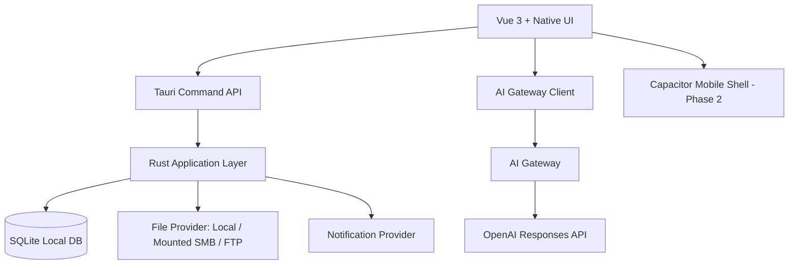

# C-teacher 技术选型方案

> 日期: 2026-05-30  
> 目标: 优先交付 macOS 桌面端，并最终生成可分发 `.dmg` 安装包；移动端复用核心业务能力。

## 结论

推荐方案: **Vue 3 + TypeScript + Native UI + Tauri v2 + SQLite + Rust 原生能力层 + Go 后端**。

这条路线最贴合当前约束:

- macOS 优先，Tauri 官方支持生成 DMG。
- 前端可以复用现有 HTML 原型的信息架构，改造成 Vue 3 应用。
- Tauri 后端可以用 Rust 接系统通知、本地文件、外部资料源、SQLite。
- 应用体积和启动速度优于 Electron。
- AI Key 不放在客户端，生产环境通过 Go AI Gateway 转发。
- 移动端先复用 Web/Vue 业务代码，第二阶段用 Capacitor 包装移动端，降低首版复杂度。

## 技术栈

| 层级 | 选择 | 说明 |
| --- | --- | --- |
| 桌面壳 | Tauri v2 | 生成 macOS `.app` 和 `.dmg`，接系统通知、文件、原生命令。 |
| 前端 | Vue 3 + TypeScript + Vite | 与当前 HTML 原型迁移成本低，适合复杂工作台。 |
| UI | Native UI + lucide-vue-next | 表格、表单、弹窗、Tabs、上传和日期控件成熟，适合教师工作台。 |
| 本地数据 | SQLite | 学生、课程、资料、课堂记录、错题本等结构化数据本地优先。 |
| 数据访问 | Rust `sqlx` + Tauri commands | 保持数据写入在原生层，前端只调用类型化命令。 |
| 状态管理 | Pinia | 管理当前学生、页面状态、筛选条件和本地缓存。 |
| 表单 | Native UI Form + Zod | 学生 CRUD、资料源、提醒、错题编辑都需要强校验。 |
| AI | OpenAI Responses API 经 AI Gateway 调用 | 支持图像输入与文本输出；客户端不保存平台密钥。 |
| 后端 | Go `net/http` 起步，后续可加 chi | 负责 AI Gateway、鉴权、限流、同步和后台任务。 |
| 拍照/图片 | 桌面端文件/相机导入；移动端 Capacitor Camera | 桌面先支持图片上传和粘贴，移动端支持拍照录入。 |
| 系统提醒 | Tauri notification plugin + 本地 reminder 表 | 首版用系统通知；后续按需接 macOS Reminders/Calendar。 |
| 资料源 | Provider 抽象: local / mounted SMB / FTP | macOS 首版支持本地目录、已挂载 SMB 目录和 FTP。 |
| 移动端 | Vue 复用 + Capacitor | 第二阶段生成 iOS/Android 壳，复用业务组件和 API。 |
| 测试 | Vitest + Testing Library + Playwright + Rust tests | 单元、组件、端到端和原生命令测试分层覆盖。 |
| 打包 | Tauri bundler | `npm run build:dmg` 生成 DMG。 |

## 为什么不是 Electron

Electron 也能稳定打 DMG，electron-builder 对 DMG、签名和自动更新都很成熟。但当前项目更偏本地资料管理、系统能力、轻量教师工具，不需要 Chromium + Node 全量运行时。Electron 的优势是生态和调试便利，代价是体积、内存和分发包更大。

如果后续强依赖复杂 Node 生态，例如大量 Office/PDF 本地处理、Node 原生模块、丰富自动更新生态，Electron 可以重新评估。

## 为什么不是 Flutter

Flutter 可以做漂亮的跨端 UI，也能打 macOS 包，但当前已经有 Web/Pencil/HTML 原型，业务界面是典型管理工作台。用 Vue 3 + Native UI 迁移成本更低，表单/表格/弹窗这些工作台基础件也更现成。

## 架构



## 关键模块边界

### 前端模块

- 工作台: 学生进度/日历计划切换。
- 学生管理: CRUD、多学科课程卡片、错题本显眼入口。
- 错题本: 学生维度入口，按科目展示错题、AI 分析、类似题。
- 课堂记录: 课后记录、作业布置、关联资料。
- 资料库: 本地资料、外部资料源、资料分配。
- 提醒: 本地提醒记录、系统通知触发。
- 设置: AI 配置、资料源、备份、隐私。

### Tauri/Rust 模块

- `student`: 学生与学科课程 CRUD。
- `mistake_book`: 错题本、错题、AI 分析结果落库。
- `material`: 资料索引、资料分配、外部资料源。
- `reminder`: 本地提醒和系统通知。
- `ai`: 调用 AI Gateway，不直连平台密钥。
- `storage`: SQLite migration、备份和导入导出。

### AI Gateway 模块

- 鉴权: 用户/设备 token。
- 限流: 按用户、功能、模型限流。
- Prompt 模板: 拍照改题、错误分析、类似题生成、知识点分析。
- 审计: 请求时间、功能类型、token 用量，不记录敏感图片原文，除非用户授权。

## DMG 交付要求

首版必须生成:

- `C-teacher.app`
- `C-teacher_<version>_universal.dmg` 或 arm64/x64 分架构 DMG
- 内部测试可先生成未签名 DMG。
- 面向外部分发必须配置 Apple Developer ID 签名和 notarization。

构建命令:

```bash
npm run build:dmg
```

## 风险与应对

| 风险 | 影响 | 应对 |
| --- | --- | --- |
| SMB 直连复杂 | MVP 延期 | V1 支持 macOS 已挂载 SMB 目录；V2 再做直连 SMB。 |
| AI Key 泄漏 | 高安全风险 | 生产环境只通过 AI Gateway；本地开发使用 `.env.local`。 |
| OCR/拍照改题准确率不稳定 | 教师不信任结果 | AI 输出默认进入“待教师确认”，不自动覆盖答案。 |
| 系统提醒口径不清 | 实现分歧 | V1 使用原生通知；Reminders/Calendar 作为增强项。 |
| DMG 签名与公证配置缺失 | 无法外部分发 | 计划中单独设置签名、公证和构建验收任务。 |

## 主要 ADR

### ADR-001: 使用 Tauri v2 作为 macOS 桌面壳

决策: 采用 Tauri v2。

原因: 目标明确要求最终生成 DMG，Tauri 官方支持 DMG 打包；同时适合本地文件、通知和 SQLite 场景，应用体积更轻。

替代方案: Electron、Flutter。

代价: Rust/Tauri 插件开发门槛高于 Electron；部分移动端能力仍需 Capacitor 或 Tauri mobile 进一步验证。

### ADR-002: 本地优先，SQLite 存储核心业务数据

决策: 学生、课程、资料索引、课堂记录、错题本和提醒使用 SQLite。

原因: 教师桌面场景更适合离线可用和本地快速查询；后续可以做云同步，不阻塞 MVP。

替代方案: IndexedDB、Postgres/Supabase。

代价: 多设备同步需要后续设计冲突处理。

### ADR-003: AI 通过 Gateway 调用，不在客户端内置平台密钥

决策: 生产环境通过 AI Gateway 调用模型。

原因: 桌面应用可被反编译，不能内置 OpenAI 等平台密钥；Gateway 还能做限流、审计和模型切换。

替代方案: 用户自带 API Key、本地模型。

代价: 需要维护一个小型服务；离线 AI 能力不在首版覆盖。

## 参考来源

- Tauri DMG 分发文档: https://v2.tauri.app/distribute/dmg/
- Tauri 分发总览: https://v2.tauri.app/distribute/
- Tauri Notification plugin: https://v2.tauri.app/plugin/notification/
- Tauri Dialog plugin: https://v2.tauri.app/plugin/dialog/
- Tauri File System plugin: https://v2.tauri.app/plugin/file-system/
- electron-builder macOS/DMG 文档: https://www.electron.build/docs/mac
- Capacitor 官网: https://capacitorjs.com/
- OpenAI Responses API: https://platform.openai.com/docs/api-reference/responses
